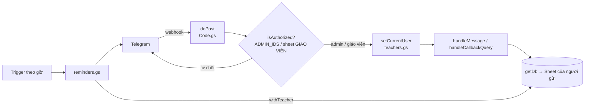

# 🚗 StudentBot — Bot Telegram quản lý học viên lái xe

Bot Telegram dành cho giáo viên dạy lái xe: quản lý học viên, lịch học, thanh toán và công nợ, lịch thi, xe tập, nhắc nhở tự động và báo cáo. Toàn bộ chạy trên **Google Apps Script**, dữ liệu lưu trong **Google Sheets**, không cần máy chủ riêng, không tốn chi phí hạ tầng.

Nhiều giáo viên dùng chung một bot, **mỗi người có một Google Sheet riêng**. Admin thêm hoặc khóa giáo viên, vào xem dữ liệu của từng người và xem tổng hợp toàn trường ngay trong Telegram.

> Tài liệu: [Hướng dẫn cho admin](docs/huong-dan-admin.md) · [Hướng dẫn cho giáo viên](docs/huong-dan-giao-vien.md) · [Tài liệu phát triển](docs/phat-trien.md) · [Lịch sử thay đổi](CHANGELOG.md)

---

## Mục lục

- [Tính năng](#tính-năng)
- [Kiến trúc](#kiến-trúc)
- [Mô hình nhiều giáo viên](#mô-hình-nhiều-giáo-viên)
- [Bắt đầu nhanh](#bắt-đầu-nhanh)
- [Lệnh của bot](#lệnh-của-bot)
- [Cấu hình](#cấu-hình)
- [Dữ liệu trong Google Sheets](#dữ-liệu-trong-google-sheets)
- [Cấu trúc mã nguồn](#cấu-trúc-mã-nguồn)
- [Kiểm thử](#kiểm-thử)
- [Giới hạn và lưu ý](#giới-hạn-và-lưu-ý)
- [Bảo mật](#bảo-mật)

---

## Tính năng

**👥 Học viên**
- Thêm học viên bằng hội thoại từng bước, bot kiểm tra số điện thoại, CMND/CCCD, ngày tháng và số tiền ngay khi nhập.
- Danh sách có phân trang, tìm kiếm theo mã, họ tên, số điện thoại hoặc CMND.
- Màn hình chi tiết với các nút: Lịch học, Thanh toán, Tiến độ, Sửa (14 trường thông tin), Xóa (có bước xác nhận).

**📅 Lịch học**
- Đặt lịch 5 bước: học viên, ngày (hiểu "hôm nay", "ngày mai"), giờ bắt đầu, giờ kết thúc, loại buổi học.
- Xem lịch hôm nay, lịch tuần này, lịch của từng học viên.

**💰 Thanh toán và công nợ**
- Thu học phí 3 bước, bot hiểu các cách viết tiền như `12tr`, `19 triệu`, `19.000.000`.
- Số đã đóng và còn nợ của học viên tự cập nhật; danh sách công nợ sắp xếp theo số nợ giảm dần.

**🎓 Lịch thi** — Đặt lịch thi (lý thuyết, thực hành, sát hạch), xem các kỳ thi sắp tới theo ngày.

**🚗 Xe tập** — Thêm xe (chặn biển số trùng), danh sách xe, theo dõi km bảo dưỡng và hạn đăng kiểm.

**🔔 Nhắc nhở tự động** (trigger theo giờ, chạy riêng cho từng giáo viên)
- Buổi học bắt đầu trong 30 phút tới (kiểm tra mỗi 15 phút).
- Tổng kết công nợ tuần (thứ Hai 9:00), admin nhận thêm bản tổng hợp toàn trường.
- Xe còn dưới 500 km đến hạn bảo dưỡng (8:00 hằng ngày).
- Xe quá hạn hoặc còn dưới 30 ngày đăng kiểm (ngày 1 hằng tháng).

**📊 Báo cáo** — Thống kê tổng quan và 5 báo cáo chi tiết: học viên, tài chính, lịch học, kỳ thi, xe tập.

**👨‍🏫 Nhiều giáo viên** — Mỗi thầy một Google Sheet riêng, admin quản lý và tổng hợp. Xem [mô hình](#mô-hình-nhiều-giáo-viên).

---

## Kiến trúc



- **Code.gs** nhận update từ Telegram, chống xử lý trùng bằng cache, kiểm tra quyền, đặt ngữ cảnh dữ liệu rồi chuyển cho handler.
- **teachers.gs** giữ sổ giáo viên, quyết định mỗi lượt xử lý đọc/ghi vào Google Sheet nào (`getDb()`).
- Các file nghiệp vụ (`student.gs`, `schedule.gs`, `payment.gs`, `vehicle.gs`, `exam.gs`) chỉ làm việc với sheet qua `getDb()`, nên cùng một mã chạy cho mọi giáo viên.
- Trạng thái hội thoại nhiều bước lưu trong `CacheService` theo user ID (hết hạn sau 30 phút).
- `telegram.gs` bọc Bot API: tự cắt tin dài hơn 4096 ký tự, tự gửi lại dạng văn bản thường nếu Markdown lỗi.

---

## Mô hình nhiều giáo viên

| Vai trò | Dữ liệu | Quyền |
|---|---|---|
| **Admin** (ID trong `ADMIN_IDS`, chưa đặt thì `TEST_CHAT_ID`) | File Sheet gốc (file chứa script) | Mọi lệnh thường; thêm/khóa giáo viên; `/chon_gv` để vào dữ liệu của một thầy; `/thong_ke`, `/xem_no` tổng hợp toàn trường |
| **Giáo viên** (dòng "Hoạt động" trong tab **GIÁO VIÊN** của file gốc) | Google Sheet riêng, bot tự tạo khi admin gõ `/them_gv` | Mọi lệnh thường trên dữ liệu của mình; nhận nhắc nhở về học viên, xe của mình |
| **Người lạ** | — | Bị từ chối, bot trả lại user ID để gửi cho admin |

- Quyền kiểm tra theo **user ID của người gửi**, nên kéo bot vào nhóm cũng chỉ người được cấp phép dùng được.
- Sheet riêng có đủ 8 tab như file gốc, nằm trong Drive của chủ script; admin có thể chia sẻ cho email của thầy ngay khi thêm.
- Mã học viên `HV001`, buổi học, giao dịch... đánh số riêng trong từng Sheet.

---

## Bắt đầu nhanh

Chi tiết từng bước có trong [Hướng dẫn cho admin](docs/huong-dan-admin.md). Tóm tắt:

1. Tạo một Google Sheet, mở **Tiện ích mở rộng → Apps Script**, đưa toàn bộ file trong `appscript/` vào (dán tay hoặc dùng `clasp push`).
2. Chạy `setupAllSheets` trong `create-sheets.gs` để tạo 8 tab dữ liệu.
3. Tạo bot với **@BotFather**, lấy token.
4. Vào **Cài đặt dự án → Thuộc tính tập lệnh**, đặt `TELEGRAM_BOT_TOKEN`, `TEST_CHAT_ID` (user ID Telegram của bạn), tùy chọn `ADMIN_NAME`.
5. **Triển khai → Ứng dụng web**: thực thi với tư cách *tôi*, ai cũng truy cập được. Lưu URL vào thuộc tính `WEB_APP_URL`.
6. Chạy `setWebhook` trong `Code.gs`, cấp quyền khi Google hỏi.
7. Chạy `installReminderTriggers` trong `reminders.gs` để bật 4 nhắc nhở tự động.
8. Gửi `/setcommands` cho BotFather với danh sách lệnh bên dưới, rồi nhắn `/start` cho bot.

---

## Lệnh của bot

| Lệnh | Chức năng |
|---|---|
| `/start` | Chào mừng, hiện ngữ cảnh dữ liệu hiện tại |
| `/help` | Danh sách lệnh (admin thấy thêm mục Admin) |
| `/huy` | Hủy thao tác đang nhập dở |
| `/them_hv` | Thêm học viên mới |
| `/ds_hv` | Danh sách học viên (phân trang) |
| `/tim_hv <từ khóa>` | Tìm theo mã, tên, SĐT, CMND |
| `/xem_HV001` | Chi tiết học viên kèm nút thao tác |
| `/dat_lich` | Đặt lịch học |
| `/lich_hom_nay` · `/lich_tuan` | Lịch hôm nay / tuần này |
| `/thu_tien` | Thu học phí |
| `/xem_no` | Danh sách công nợ (admin ở file gốc: toàn trường) |
| `/dat_lich_thi` · `/ds_thi` | Đặt lịch thi / danh sách lịch thi |
| `/them_xe` · `/ds_xe` | Thêm xe / danh sách xe |
| `/thong_ke` | Thống kê tổng quan (admin ở file gốc: toàn trường) |
| `/bao_cao` | Báo cáo chi tiết theo nhóm |
| `/them_gv <ID> <Tên> [email]` | *(Admin)* Thêm giáo viên, tạo Sheet riêng |
| `/ds_gv` | *(Admin)* Danh sách giáo viên |
| `/xoa_gv <ID>` | *(Admin)* Khóa giáo viên |
| `/chon_gv [ID]` | *(Admin)* Vào dữ liệu của một thầy / quay về file gốc |

Danh sách dán vào BotFather (`/setcommands`):

```
start - Bắt đầu
help - Hướng dẫn
huy - Hủy thao tác đang thực hiện
them_hv - Thêm học viên
ds_hv - Danh sách học viên
tim_hv - Tìm kiếm học viên
dat_lich - Đặt lịch học
lich_hom_nay - Lịch hôm nay
lich_tuan - Lịch tuần này
thu_tien - Thu tiền học phí
xem_no - Danh sách công nợ
dat_lich_thi - Đặt lịch thi
ds_thi - Danh sách lịch thi
ds_xe - Danh sách xe
them_xe - Thêm xe mới
thong_ke - Thống kê tổng quan
bao_cao - Báo cáo chi tiết
them_gv - (Admin) Thêm giáo viên
ds_gv - (Admin) Danh sách giáo viên
xoa_gv - (Admin) Khóa giáo viên
chon_gv - (Admin) Vào dữ liệu của một thầy
```

---

## Cấu hình

Tất cả nằm trong **Cài đặt dự án → Thuộc tính tập lệnh** của Apps Script. Không có giá trị nào được ghi trong mã.

| Thuộc tính | Bắt buộc | Ý nghĩa |
|---|---|---|
| `TELEGRAM_BOT_TOKEN` | ✅ | Token từ BotFather |
| `WEB_APP_URL` | ✅ | URL `/exec` của ứng dụng web đã triển khai, dùng cho `setWebhook` |
| `TEST_CHAT_ID` | ✅ | User ID Telegram của bạn; là admin mặc định khi chưa đặt `ADMIN_IDS` |
| `ADMIN_IDS` | – | Danh sách user ID admin, cách nhau bằng dấu phẩy |
| `ADMIN_NAME` | – | Tên hiện ở nút "Tôi" khi nhập giáo viên phụ trách và trong /start của admin |
| `VIEW_AS_<id>` | tự động | Bot tự ghi khi admin dùng `/chon_gv`, không cần sửa tay |

---

## Dữ liệu trong Google Sheets

Mỗi Sheet (file gốc và từng Sheet của giáo viên) có 8 tab do `setupAllSheets` tạo, kèm dropdown, công thức và định dạng:

| Tab | Nội dung chính |
|---|---|
| `THÔNG TIN HỌC VIÊN` | ID, họ tên, ngày sinh, giới tính, SĐT, CMND/CCCD, địa chỉ, ngày nộp hồ sơ, loại bằng, giáo viên phụ trách, trạng thái, học phí, đã đóng, còn nợ, ghi chú |
| `LỊCH HỌC` | ID buổi, ngày, giờ bắt đầu/kết thúc, học viên, loại buổi (Lý thuyết/Thực hành/Sa hình), địa chỉ đón/trả, xe, trạng thái, giáo viên, đánh giá |
| `TIẾN ĐỘ HỌC TẬP` | Giờ lý thuyết/thực hành, % hoàn thành, các kỹ năng, điểm thi |
| `THANH TOÁN` | ID giao dịch, ngày giờ, Thu/Chi, khoản mục, học viên, số tiền, hình thức, người thu, biên lai |
| `QUẢN LÝ XE` | Biển số, loại bằng phù hợp, loại xe, km hiện tại, trạng thái, đăng kiểm, bảo dưỡng |
| `LỊCH THI` | ID kỳ thi, học viên, loại thi, ngày giờ, địa điểm, kết quả |
| `NHẮC NHỞ` | Nhật ký các tin nhắc đã gửi (loại, nội dung, ngày giờ, đối tượng) |
| `BÁO CÁO THỐNG KÊ` | Số liệu theo tháng |

Riêng file gốc có thêm tab **`GIÁO VIÊN`** (User ID, Tên, Spreadsheet ID, URL, Trạng thái, Ngày tạo) do bot tự tạo và quản lý.

Trạng thái học viên: `Chờ xử lý hồ sơ`, `Đang học`, `Chờ thi`, `Đã tốt nghiệp`, `Bỏ học`. Loại bằng: `A1, A2, B1, B2, C, D, E`.

---

## Cấu trúc mã nguồn

```
appscript/
├── appsscript.json          # Manifest: V8, múi giờ Asia/Ho_Chi_Minh, cấu hình web app
├── Code.gs                  # Webhook doPost, định tuyến lệnh, /start, /help, setWebhook
├── teachers.gs              # Phân quyền admin/giáo viên, ngữ cảnh dữ liệu (getDb), lệnh admin, tổng hợp
├── telegram.gs              # Gọi Bot API: sendMessage, editMessage, bàn phím inline
├── conversation.gs          # Trạng thái hội thoại, luồng thêm học viên
├── callbacks.gs             # Xử lý nút bấm (callback_query)
├── student.gs               # CRUD học viên; list-students.gs, search-student.gs, view-student.gs, edit-student.gs
├── schedule.gs              # Lịch học; schedule-conversation.gs, view-schedules.gs
├── payment.gs               # Thanh toán, công nợ; payment-conversation.gs, view-debt.gs
├── exam.gs                  # Lịch thi; exam-conversation.gs, view-exams.gs
├── vehicle.gs               # Xe tập; vehicle-conversation.gs, view-vehicles.gs
├── reminders.gs             # 4 nhắc nhở tự động và trigger
├── statistics.gs, reports.gs# Thống kê và báo cáo
├── create-sheets.gs         # Tạo 8 tab, dropdown, công thức; migrateExamSheet
├── utils.gs                 # Định dạng ngày/tiền, parse ngày, validate
├── test-webhook.gs          # dryRunWebhook: chạy khô toàn bộ luồng bot trong trình soạn
└── test-*.gs, debug.gs      # Hàm thử nghiệm chạy tay
tests/                       # Test Node (stub Apps Script) cho teachers.gs và edit-student.gs
docs/                        # Hướng dẫn admin, giáo viên, phát triển; docs/archive là tài liệu thiết kế cũ
```

---

## Kiểm thử

- **Test Node, không cần Google:** `node tests/test_teachers.js appscript` và `node tests/test_edit_student.js appscript` nạp mã `.gs` thật với stub tối thiểu cho Apps Script.
- **Kiểm tra cú pháp:** sao chép `.gs` sang `.js` rồi `node --check`.
- **Chạy khô trên dữ liệu thật:** chạy `dryRunWebhook` (file `test-webhook.gs`) trong trình soạn Apps Script. Hàm này đẩy 29 lệnh và nút bấm qua đúng luồng xử lý, chặn mọi lệnh gọi Telegram và in nội dung bot định trả lời ra Execution log. Không gửi tin, không ghi sheet.

Xem thêm trong [Tài liệu phát triển](docs/phat-trien.md).

---

## Giới hạn và lưu ý

- Hạn mức Apps Script tài khoản thường: khoảng 20.000 lượt gọi URL mỗi ngày (mỗi tin nhắn gửi đi là một lượt), mỗi lần thực thi tối đa 6 phút.
- Bot trả lời sau 2–4 giây vì mỗi lượt là một lần khởi động Apps Script; `/them_gv` mất khoảng 40 giây để dựng 8 tab cho Sheet mới.
- Trigger theo giờ của Google chạy trong khoảng giờ đã chọn (ví dụ 8:00–9:00), không đúng từng phút.
- Log của các lượt webhook không xem được trong trang Thực thi; dùng `dryRunWebhook` khi cần xem nội dung bot trả lời.
- Không đổi tên tab hay tiêu đề cột trong Sheet; bot đọc theo vị trí cột.

---

## Bảo mật

- Token bot và mọi cấu hình nằm trong Script Properties, không có trong mã nguồn. `.clasp.json` (chứa Script ID) nằm trong `.gitignore`, có file mẫu `.clasp.json.example`.
- Chỉ admin và giáo viên đang hoạt động mới dùng được bot; kiểm tra theo user ID người gửi.
- Mỗi giáo viên chỉ chạm tới Google Sheet của mình; bot chạy với tư cách chủ script nên giáo viên không cần được cấp quyền Google.
- Xóa học viên luôn phải xác nhận; khóa giáo viên không xóa dữ liệu của họ.
